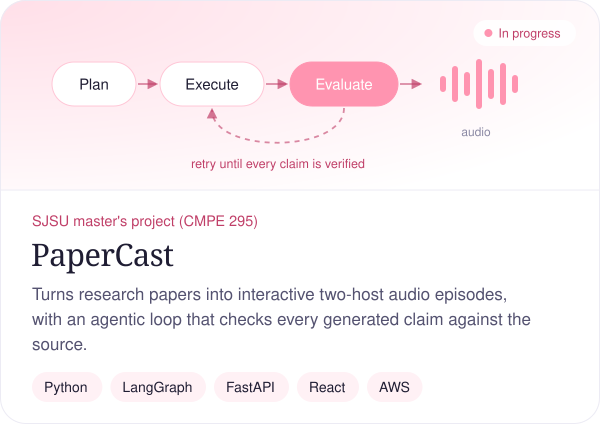
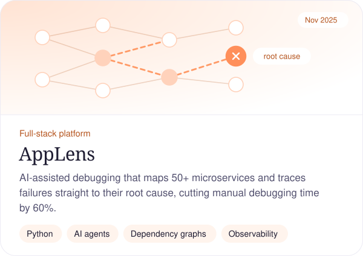
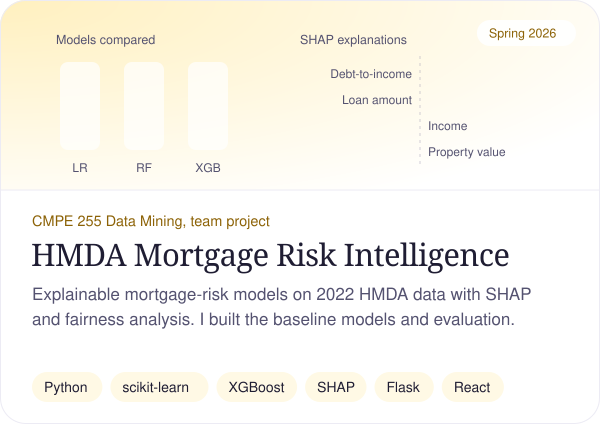

  <a href="https://sreyasomisetty17.github.io/Portfolio/"><b>Portfolio</b></a> &nbsp;&nbsp;|&nbsp;&nbsp;
  <a href="https://www.linkedin.com/in/sreyasomisetty/"><b>LinkedIn</b></a> &nbsp;&nbsp;|&nbsp;&nbsp;
  <a href="mailto:sreyasomisetty@gmail.com"><b>Email</b></a> &nbsp;&nbsp;

## What I've built

  
  

  
  

Click a card to open the repository.

## Experience

**Software Engineer III, Oracle** &nbsp;·&nbsp; 2021 – 2025 
Kafka-driven Java microservices for Eloqua SMS processing 500K+ messages a day, REST APIs serving 1M+ requests a month, and Prometheus and Grafana alerting that cut production incidents by 40%.

**Software Engineer I, NCR** &nbsp;·&nbsp; 2019 – 2021 
Rewrote a reporting module to run 50% more efficiently, mentored junior engineers and led sprint planning.

## Toolbox

